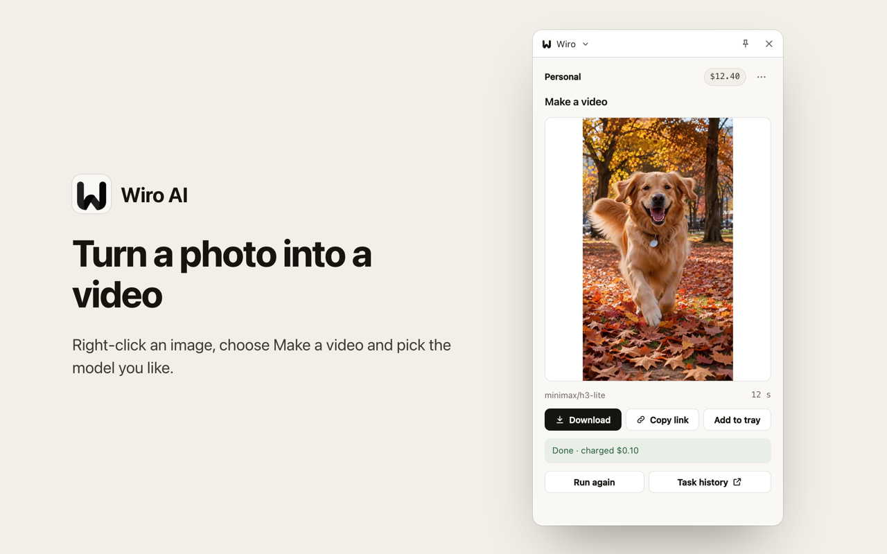
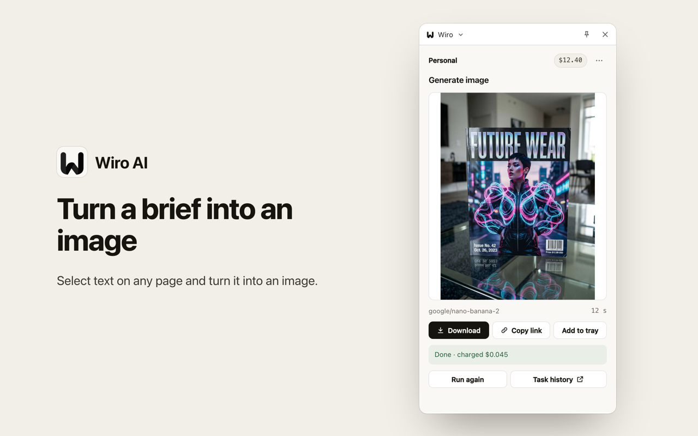
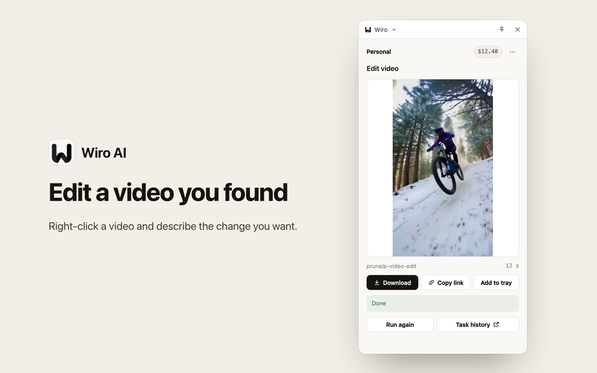
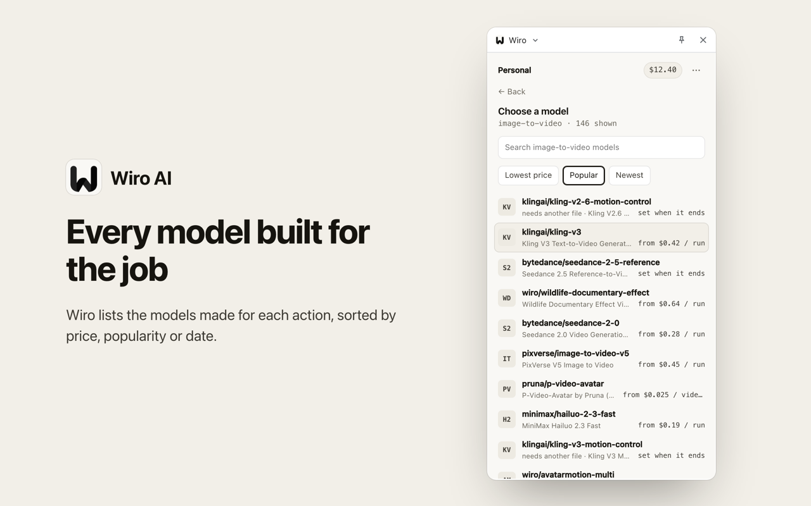
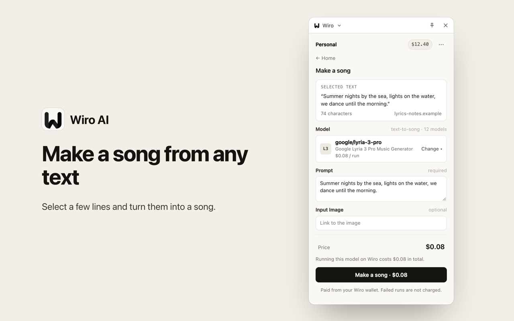
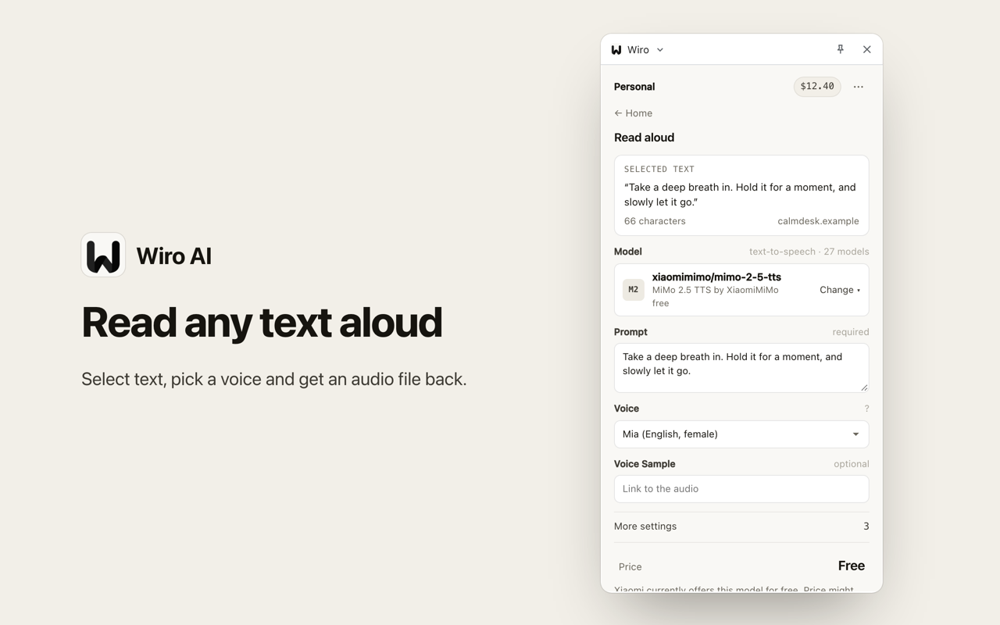
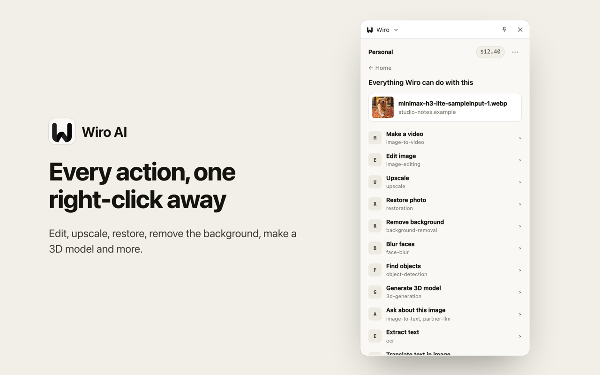
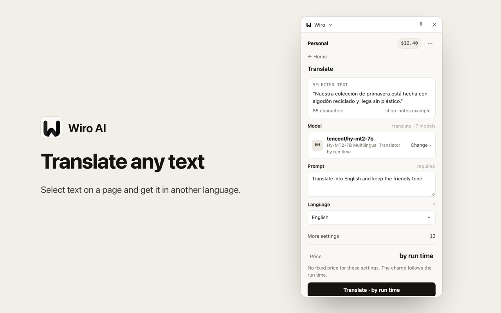
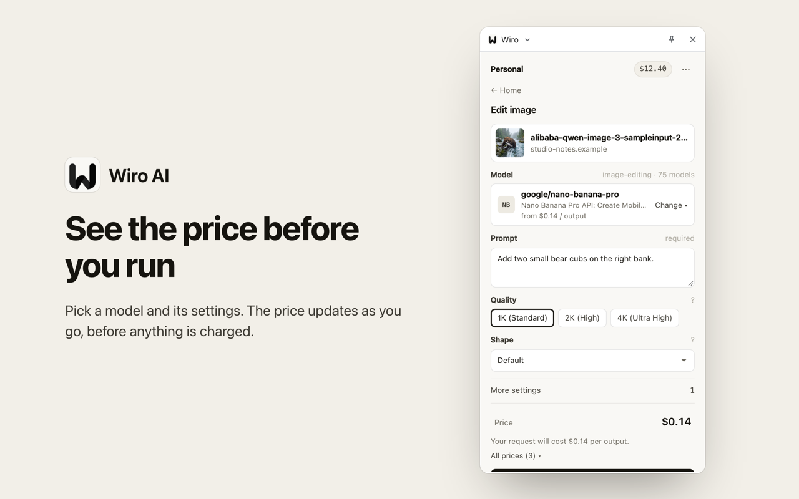

<div align="center">


# Wiro Extension Core: Shared Code of the Wiro AI Browser Extensions

Sign-in, the Wiro MCP client, the right-click action catalog, the model gateway, pricing and the panel UI, shared by the Wiro AI extensions for Chrome, Edge, Opera, Whale, Firefox and Safari.

[](./tsconfig.json) [](./src/ui) [](./test) [](./LICENSE)

[Website](https://wiro.ai) · [Models](https://wiro.ai/models) · [Docs](https://wiro.ai/docs) · [Dashboard](https://wiro.ai/panel)


</div>

Wiro Extension Core is the part of the Wiro AI browser extensions that does not depend on the browser. Each browser repo includes it as the `core/` git submodule and adds a small platform adapter, so a fix or a new action reaches every browser at once.

<p align="center">
  
  
</p>
<p align="center">
  
  
</p>
<p align="center">
  
  
</p>
<p align="center">
  
  
</p>
<p align="center">
  
  
</p>

## Used by

| Repository | Browsers |
| --- | --- |
| [Wiro-Chromium-Extension](https://github.com/wiroai/Wiro-Chromium-Extension) | Chrome, Edge, Opera, Whale, Brave and other Chromium browsers |
| [Wiro-Firefox-Extension](https://github.com/wiroai/Wiro-Firefox-Extension) | Firefox 140 and later |
| [Wiro-Safari-Extension](https://github.com/wiroai/Wiro-Safari-Extension) | Safari 16.4 and later on the Mac |

## What is inside

- `src/auth`: sign-in with a Wiro account through the OAuth 2.1 server at `mcp.wiro.ai` (PKCE, refresh, revoke). No API key in the browser.
- `src/mcp`, `src/wiro`: a small client for the stateless MCP endpoint `https://mcp.wiro.ai/v1` and the Wiro tools the extension uses.
- `src/catalog`: the right-click actions. Every action points at Wiro model categories, never at fixed models, and the models come live from each category. The extension ships with a built-in action list and uses the one on wiro.ai when that loads.
- `src/gateway`: maps one set of inputs (the clicked file, the prompt, length, quality, shape) onto each model's own parameter names, so every model in a category works with the same panel.
- `src/pricing`: the price on the run button, worked out from the model's price rows the way Wiro bills a run, or from its price summary.
- `src/ui`: the panel (Preact). The browser repos show it in a side panel, a sidebar, a popup or a tab.
- `src/platform.ts`: the interface each browser implements.

## How a run works

1. A right-click hands the background the clicked item: its address, the selected text or the page address.
2. The action's categories load their models live from Wiro, sorted by price, popularity or date.
3. The gateway fills the chosen model's parameters from the shared inputs and asks only for what is still missing.
4. The panel shows the price for the settings chosen, before the run.
5. The run goes through the Wiro MCP server; the panel follows it and shows the result, which you can download, copy or keep in the tray.

## Platform adapter

A browser repo implements `Platform` from `src/platform.ts`:

| Member | What it does |
| --- | --- |
| `storage`, `session` | key-value storage that lasts across restarts, and one that lasts while the browser runs |
| `redirectUri()` | the OAuth redirect address this browser can catch |
| `launchAuth(url)` | opens the sign-in window and returns the address the server redirected to; Safari finishes the sign-in in a tab instead |
| `openTab(url)` | opens a link in a new tab |
| `name`, `version`, `clientName` | the browser, the extension version and the name shown on the Wiro consent page |

## Development

Requires Node.js 22 or later.

```bash
npm install
npm test
npm run typecheck
```

`test/harness/` renders the panel in headless Chrome against a local stand-in for the Wiro MCP server, using Wiro's public model catalog, and saves a screenshot per step. Usage is at the top of `drive.mjs` and `mock-mcp.mjs`.

## More from Wiro AI

| Repository | What it is |
| --- | --- |
| [Wiro-Chromium-Extension](https://github.com/wiroai/Wiro-Chromium-Extension) | Wiro AI extension for Chrome, Edge, Opera, Whale and Brave |
| [Wiro-Firefox-Extension](https://github.com/wiroai/Wiro-Firefox-Extension) | Wiro AI add-on for Firefox |
| [Wiro-Safari-Extension](https://github.com/wiroai/Wiro-Safari-Extension) | Wiro AI extension for Safari on the Mac |
| [Wiro-MCP](https://github.com/wiroai/Wiro-MCP) | Official MCP server for Wiro AI, [`@wiro-ai/wiro-mcp` on npm](https://www.npmjs.com/package/@wiro-ai/wiro-mcp) |
| [Wiro-Plugin](https://github.com/wiroai/Wiro-Plugin) | Wiro AI plugin for Cursor, Claude Code, Gemini CLI, Devin, Antigravity and Kiro |
| [Wiro-LLM](https://github.com/wiroai/Wiro-LLM) | Vercel AI SDK provider for chat, images, speech, transcription and video |
| [Swift-QuickStart](https://github.com/wiroai/Swift-QuickStart) | WiroKit, the Wiro AI SDK for iOS |
| [Kotlin-QuickStart](https://github.com/wiroai/Kotlin-QuickStart) | WiroKit, the Wiro AI SDK for Android |
| [Dart-QuickStart](https://github.com/wiroai/Dart-QuickStart) | Wiro AI SDK for Dart and Flutter, [`wiro` on pub.dev](https://pub.dev/packages/wiro) |
| [ReactNative-QuickStart](https://github.com/wiroai/ReactNative-QuickStart) | Wiro AI SDK for React Native and Expo, [`@wiro-ai/wiro-react-native` on npm](https://www.npmjs.com/package/@wiro-ai/wiro-react-native) |
| [Swift-Realtime](https://github.com/wiroai/Swift-Realtime) | Realtime voice AI example for iOS |
| [Kotlin-Realtime](https://github.com/wiroai/Kotlin-Realtime) | Realtime voice AI example for Android |
| [Dart-Realtime](https://github.com/wiroai/Dart-Realtime) | Realtime voice AI example for Flutter |
| [ReactNative-Realtime](https://github.com/wiroai/ReactNative-Realtime) | Realtime voice AI example for React Native |
| [n8n-nodes-wiroai](https://github.com/wiroai/n8n-nodes-wiroai) | Wiro AI nodes for n8n, [`@wiro-ai/n8n-nodes-wiroai` on npm](https://www.npmjs.com/package/@wiro-ai/n8n-nodes-wiroai) |
| [Wiro-Dify-Plugin](https://github.com/wiroai/Wiro-Dify-Plugin) | Wiro AI plugins for Dify: the LLM gateway as a model provider, plus image, video, speech and music tools |
| [Wiro-ComfyUI](https://github.com/wiroai/Wiro-ComfyUI) | Wiro AI nodes for ComfyUI |
| [Wiro-Hermes](https://github.com/wiroai/Wiro-Hermes) | Wiro AI plugins for Hermes Agent: image, video, audio and 3D tools, plus the LLM gateway as a model provider |
| [Wiro-Zed](https://github.com/wiroai/Wiro-Zed) | Wiro AI MCP server extension for Zed |
| [Wiro-Action](https://github.com/wiroai/Wiro-Action) | GitHub Action for Wiro AI models and the LLM gateway, [on the GitHub Marketplace](https://github.com/marketplace/actions/wiro-ai-action) |
| [Wiro-Raycast](https://github.com/wiroai/Wiro-Raycast) | Wiro AI extension for Raycast: image and video generation, LLM chat and model search |
| [Wiro-WordPress](https://github.com/wiroai/Wiro-WordPress) | Wiro AI plugin for WordPress: featured images, image edits, alt text, narration and SEO suggestions |
| [Wiro-Obsidian](https://github.com/wiroai/Wiro-Obsidian) | Wiro AI plugin for Obsidian: images, video, speech, music, transcription and text tools |
| [Wiro-Blender](https://github.com/wiroai/Wiro-Blender) | Wiro AI add-on for Blender: text to 3D, image to 3D and textures |
| [Wiro-Figma](https://github.com/wiroai/Wiro-Figma) | Wiro AI plugin for Figma: images, vectors, image edits and text |
| [Wiro-Next-Starter](https://github.com/wiroai/Wiro-Next-Starter) | Next.js starter for Wiro AI: Playground, image, video and audio tools, and LLM chat, ready for Vercel and Railway |
| [Wiro-Docs](https://github.com/wiroai/Wiro-Docs) | Source of the Wiro AI API docs |

[Website](https://wiro.ai) · [Models](https://wiro.ai/models) · [Docs](https://wiro.ai/docs) · [X](https://x.com/wiroai)

## License

MIT, see [LICENSE](./LICENSE).
